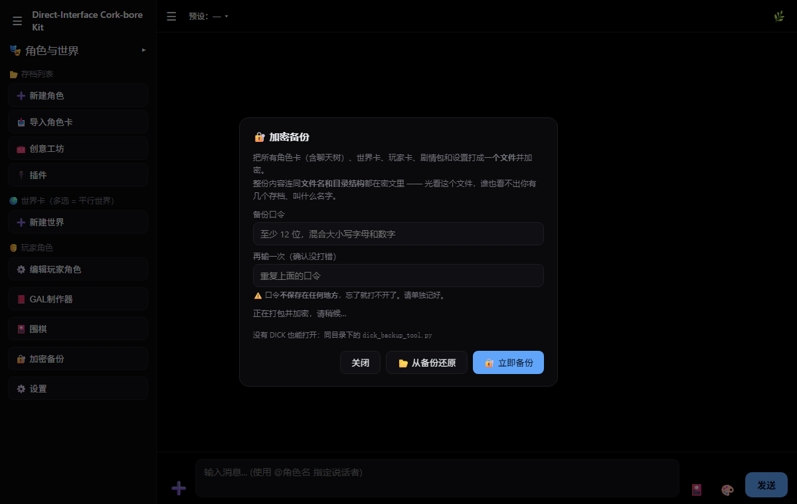
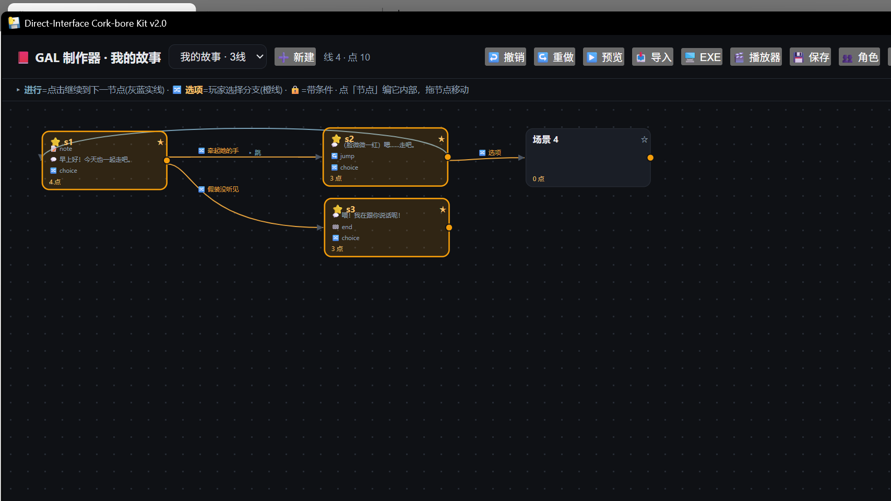

# Direct-Interface Cork-bore Kit（DICK）

> 本地 AI 角色扮演 / 交互叙事平台 · 树状记忆 · 机制养成 · CODEX 成作引擎
> **电脑**（Python + pywebview）· **手机**（Kotlin + Compose）· **原生播放器**（Compose Multiplatform）
> 免费 · 离线优先 · 数据全在你自己机器上





---

## 一分钟看懂

| 项 | 现状 |
|---|---|
| **是什么** | 和 SillyTavern（酒馆）同一沙盒的另一种玩法：轻量、开箱即用，侧重"把角色卡变成能玩的东西"（GAL 选项 / 机制养成 / 一键成作）。角色卡与酒馆互通（v1/v2/v3、PNG 嵌卡） |
| **三端** | 桌面（Python + pywebview）· 安卓（Kotlin + Compose）· 原生播放器（Compose Multiplatform，EXE 与 APK 同源） |
| **规模** | 受控文件 **505 个**；Python 224 / Kotlin 110 / JS 28；单测 **96 个脚本**（整套 91 个脚本 / **3,103 条断言 / 0 失败**） |
| **架构** | **微内核**：`kernel/`（装模块、给服务、发事件）+ `modules/<id>/`（业务块）+ 壳层（桌面/安卓/服务器）。规则见 [ARCHITECTURE.md](ARCHITECTURE.md) |
| **版号** | `version.json` 是唯一真相，四段 `大版本.架构大改.插件更新.功能测试`，当前 **1.0.0.1**（code 1000001） |
| **许可** | MIT |

---

## 怎么跑起来

### 桌面（Windows，Python 3.11 / 3.12）

```powershell
pip install -r requirements.txt
python "Direct-Interface Cork-bore Kit.py"
```

### 安卓

```powershell
cd DICK-Android
.\gradlew.bat :app:assembleDebug --offline --no-daemon
# 产物：app\build\outputs\apk\debug\app-debug.apk
```

### 创意工坊服务器（可选，局域网 / 公网分享用）

```powershell
python net.py --host 0.0.0.0 --port 8080        # 有 waitress 自动用它跑多线程
python deploy\selfcheck_workshop.py --base http://127.0.0.1:8080 --full
```

部署/迁移/扩容见 [创意工坊服务器部署.md](创意工坊服务器部署.md)；一键部署器 `deploy/deploy_workshop.py`。

---

## 工程纪律（这是本项目最反常的地方）

**代码不是写给人读的，是写给"三个月后的自己"审的。** 所以规矩都做成了机器能查的东西，而不是文档里的口号：

| 闸门 | 命令 | 拦住什么 |
|---|---|---|
| 块验收 | `python tools/accept.py` → `ALL_BLOCKS_OK` | 块自检、依赖成环、行数棘轮、接口签名漂移、唯一真相互检 |
| 内核边界 | `python tools/audit_kernel_boundaries.py` | 内核认识业务、模块互相 import、`# noqa` 绕过、块内可变全局 |
| 可移植性 | `python tools/portability_check.py` | 块偷偷依赖宿主（搬家测试：只带 `kernel/` 拷到临时目录还能自检通过） |
| UI 解耦 | `python tools/audit_ui_coupling.py` | 大文件、行内样式、硬编码颜色、全局变量、屏间耦合、组件复用（只看分数是否上升） |
| 结构守恒 | `python tools/ui_snapshot.py --check` | 搬家时 DOM / CSS / 行内样式是否被顺手改掉 |
| 视觉 | `python tools/audit_contrast.py`、`tests/test_no_dim_text.py` | 浅灰字、对比度 <4.5 |
| 文案 | `tests/test_no_emoji_ui.py`、`tests/test_no_dev_copy.py` | UI 里的 emoji 字符、HTTP 码/地址/gzip 这类技术说明 |
| 唯一真相 | `tools/gen_*.py --check` | 手改了生成产物（图标/文案/令牌/卡片字段/对拍表） |
| 全套 | `python tools/run_local_suite.py` | 91 脚本 / 3,103 断言；CI 三平台（Linux 3.11/3.12 + Windows）都跑，并且**先跑 `accept.py` 再跑全测** |

规矩本身怎么改，写在 [ARCHITECTURE.md](ARCHITECTURE.md) 第八节（反修正主义：改铁律要写原因、同期改测试与基线、留修订记录）；改代码的手艺在第九/十节（**替换优先**、**积木协议：架构由人定，AI 只在已声明的块里填文件**）。

---

## 代码地图

```
kernel/                    微内核：registry(服务) / bus(事件) / loader(按 manifest 装配) / manifest(五校验)
                           config / paths / log / version —— 不认识任何业务
modules/                   业务块（每块一个目录，唯一入口 module.py:register(kernel)）
  backup/                  加密备份（crypto_core 能力 + 铺盘/回滚）
  workshop/                创意工坊客户端（列表/上传/下载/点赞/进度，gzip 通道 + 500ms 闸门）

Direct-Interface Cork-bore Kit.py  壳层：HtmlApp（对外 api_* 门面，内部转调块）
DICK_core.py               对话内核（树状记忆、机制判定、提示词装配）
net.py                     创意工坊服务器（类型注册表 cards/worlds/plugins/packs、gzip、限流、waitress）
save_guard.py              存档修复/备份恢复（同秒备份分不出新旧时**停止自动恢复**，不静默挑一个）

web/                       桌面前端（单页 + 碎片屏）
  index.html               挂载点 + 骨架（13 个屏片段通过 <!--@screen:name--> 挂入）
  screens/*.html           13 个屏片段
  js/screens/*.js          屏逻辑；js/state.js(状态与总线) / js/router.js / js/store/
  styles/*.css             令牌与各屏样式（全部从 HTML 抽出）
  icons.js / i18n.js       生成物（来源 icons/icons.json、lang/strings.json）

DICK-Android/              安卓（单包多模块目录）
  ui/screens/<feature>/    10 个 feature 包（chat/settings/workshop/lifeSpace/trpg/cardEdit/backup/library/common/api）
  ui/components/           共享组件（按钮/卡片/输入/对话框/空态）
  core/                    平台能力（Workshop 客户端、CardIo、I18n…）

design/ · lang/ · icons/   唯一真相源（令牌 / 文案三语 / 图标名），改这里再生成
tools/                     生成器 + 审计器 + 部署器 + 跑批（19 个脚本）
tests/                     96 个独立测试脚本（含 Node 图标回归、安卓结构检查、跨端对拍）
deploy/                    工坊服务器部署器 / 自检 / nginx 样例
```

---

## 唯一真相与生成链

改**一处**，三端一起变；改漏了测试会红。

| 数据 | 唯一真相 | 生成物 | 防漂移 |
|---|---|---|---|
| 界面文案（中/英/日） | `lang/strings.json` | `web/i18n.js`、`I18nStrings.kt` | `gen_i18n.py --check` + `test_i18n_langs.py` |
| 图标（名字 → Material Symbols） | `icons/icons.json` | `web/icons.js`、`IconNames.kt` | `gen_icons.py --check` + `test_icon_scopes.py` |
| 设计令牌（颜色/间距/字号） | `design/tokens.json` | `web/theme.css`、`Tokens.kt`、`DickTheme` | `gen_tokens.py --check` + `audit_contrast.py` |
| 角色卡字段渲染顺序 | `design/card_fields.json` | `web/card_fields.js`、`CardFields.kt` | `gen_card_fields.py --check` + `test_card_view.py` |
| 版号 | `version.json` | 桌面运行时 / Gradle / 前端 `api_state()` | `test_version_consistency.py` |

---

## 现在的欠账（不粉饰）

| 欠账 | 规模 | 什么时候必须还 |
|---|---|---|
| `web/index.html` 仍是巨石 | 6,081 行；codex（编年史）/ gal（GAL 制作器）正在搬出 | 正在还（前端解耦批次） |
| 网页组件层还很薄 | 只有 `Button.js`，`index.html` 里仍有大量裸控件 | 做主题/浅色适配时 |
| 硬编码颜色残留 | 审计 ~268 处 | 同上 |
| 内核只迁了 2 个块 | 剩余清单：`image_gen` → `voice` → `codex` → 导出/文档 → `world_packs` → `trpg` → `cards` → `memory` → `chat`(DICK_core，最硬) | 按批次迁，不搞大手术 |
| 索引是单个 `index.json` | 作品数到 300~500 会疼 | 到量换 SQLite（WAL） |

---

## English (short)

**DICK** is a **local-first AI roleplay / interactive-narrative platform** — a lightweight alternative in the
same sandbox as SillyTavern, focused on turning character cards into playable things (choice-driven scenes,
mechanics/affection systems, one-click story export).

- **Three targets, one spec:** Python + pywebview desktop · Kotlin/Compose Android · Compose Multiplatform player
- **Micro-kernel architecture:** `kernel/` (services, event bus, manifest-driven loader) + `modules/<id>/`
  portability-checked blocks + thin shells. Rules live in [ARCHITECTURE.md](ARCHITECTURE.md)
- **Engineering gates in CI:** block acceptance (`tools/accept.py`), kernel boundaries, portability
  relocation tests, UI coupling score, contrast/emoji/dev-copy gates, and generated-artifact drift checks —
  91 scripts / 3,103 assertions, green on Linux 3.11/3.12 and Windows
- **Runs from source:** `pip install -r requirements.txt` then `python "Direct-Interface Cork-bore Kit.py"`
  (Python 3.11/3.12, Windows). The UI ships in 中文 / English / 日本語
- **Your data stays on your machine** · MIT licensed

Issue reports currently arrive over QQ rather than GitHub Issues; English docs are not available yet.
