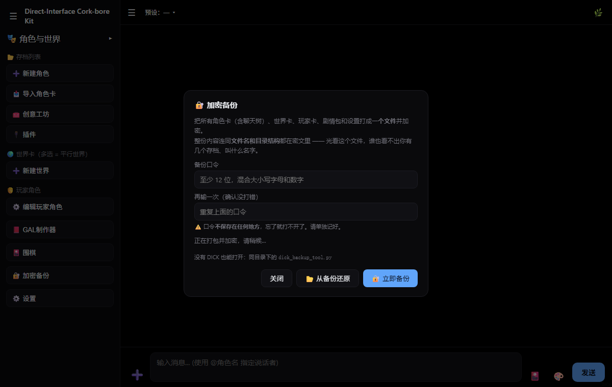
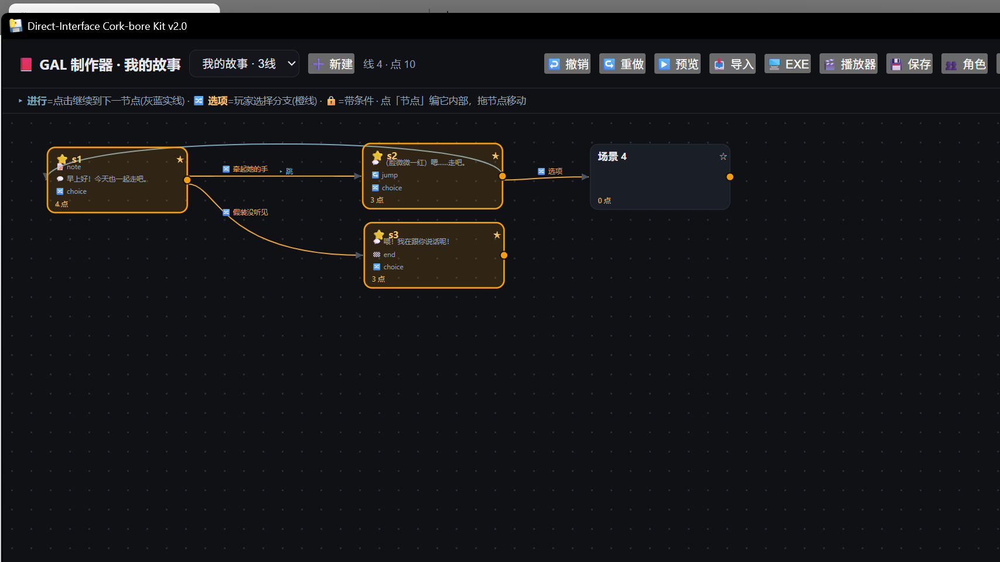

# Direct-Interface Cork-bore Kit（DICK）

> 本地优先的 AI 角色扮演与交互叙事平台 · 免费 · 离线可用 · 数据全在你自己机器上
> **电脑**（Windows 桌面版）· **手机**（Android 原生 App）· **原生播放器**（桌面 / 安卓同源）





---

## 它能干嘛

DICK 和 SillyTavern（酒馆）处在同一个沙盒里，但重点放在**把角色卡变成真的能玩、有生活、有世界演进、还能做成独立作品的东西**——同时顺手装进了跑团、办公写作与财报分析，开箱即用。

### 1. 角色扮演、群聊与多模式互动

- **角色卡与酒馆互通**：支持结构化角色设定（外貌、性格、经历、说话方式、开场白、对话示例）与 AI 一键起草；原生双向兼容酒馆（SillyTavern）v1/v2/v3 JSON 与 PNG/WebP 嵌卡，导入即用、导出可回酒馆。
- **单聊与群聊**：单选即单聊，多选直接拉群；支持 `@角色名` 指定发言、角色自动接话、按角色分色显示。
- **多玩法模式**：区分 **GAL 攻略（观测视角）**、**乙女·梦向（代入视角）**、**单推 / 小说叙事 / 跑团主持人** 等不同演出口径，配套选项推进、好感/数值机制养成与玩家角色卡（PC）。
- **树状对话与消息操作**：任意节点编辑并开新分支、随时切回历史分支不丢内容；支持多候选回复（Swipe）、流式输出，以及**引用某条消息回复**（桌面与安卓互通，引用摘要自动带进上下文）。

### 2. 平行世界、生活层与空间层

- **平行世界自由穿梭**：角色卡与世界卡彻底解耦，多选世界卡即组成可穿梭世界池；随时 `/穿越` 切换世界而完整保留角色人设与记忆。支持 8 项世界参数（科技、超自然、物理法则、时间流速等）与完整世界书（关键词/正则、权重、概率、递归触发、常驻条目）。
- **生活层（吃饭与世界时钟）**：按时间倍率运转的世界时钟，内置 10 个历史年代的厨具与食材约束（比如史前没有铁锅不能炒、明清之前吃不到辣椒和土豆），让角色的三餐与日常细节有连续性。
- **空间层（不能瞬移）**：内置地点路程、路费、营业时间与室内家屋约束，角色移动需要耗费时间，不会凭空瞬移。
- **离线推进**：隔一段时间重新打开，世界会按软件时间往前走（好感衰减、数值回归、事件冷却）；先弹预览卡片，确认才生效，且支持一键撤销。

### 3. 长期记忆（私聊 / 群聊不串味）

- **按角色与场景独立存档**：私聊、群聊与共享世界记忆分开存储，互不污染又能随时互读；对话超长时自动归档原文并生成摘要，但**不改写原始对话树**，回档随时找回原文。
- **事实、推测与画像分离**：用户亲口说过/做过的事记入带出处的事实库（`facts`），模型的相处推测单独记录（`rapport`），再由长期事实聚合出人物画像，避免把一次性说法或幻觉洗成设定。

### 4. GAL 制作器与 CODEX 一键成作

- **可视化节点图编辑器**：线-点-分支式 GAL 编辑器，直接编排剧情节点、分支走向、立绘与演出。
- **CODEX 成作引擎**：支持剧本/立绘导入、工程校验、导出与打包；配合跨平台原生播放器（`DICK-Narrative`，桌面 EXE 与安卓 APK 同源），把做好的互动故事直接打包成可玩作品。

### 5. TRPG 跑团

- 独立跑团界面，搭配玩家角色卡（PC）、世界书、朝代/年代常识库、状态变量与数值判定机制，方便单人或 AI 主持跑团。

### 6. 生图、语音与界面定制

- **AI 生图**：内置生图面板与自定义风格预设，支持固定种子复现、一键重抽，以及聊天附图与头像裁剪。
- **语音朗读（TTS）**：支持日文等语音合成朗读与本地缓存。
- **界面与主题**：支持 OLED 暗色与多套主题、Live2D 展示、中 / 英 / 日三语切换。

### 7. 办公写作与财报分析

- **办公 / 公文模式**：内置公文写作预设，支持直接读写与规范排版 Word / Excel 文档。
- **财报与个股分析**：内置 1617–2026 金融史年表、政策抓取与免 Key 个股分析数据源，可联动联网搜索做综合研判。

---

## 怎么跑起来

### 电脑端（Windows，Python 3.11 / 3.12）

```powershell
pip install -r requirements.txt
python "Direct-Interface Cork-bore Kit.py"
```

### 安卓端（Android）

与电脑端数据互通，支持角色/世界卡长按 1 秒编辑、引用对话、生活/空间/世界记忆三层与创意工坊：

```powershell
cd DICK-Android
.\gradlew.bat :app:assembleDebug --offline --no-daemon
# 产物：app\build\outputs\apk\debug\app-debug.apk
```

### 自建创意工坊服务器（可选）

```powershell
python net.py --host 0.0.0.0 --port 8080
```

---

## 更多文档

- 详细操作与命令说明：[说明书.md](说明书.md)
- 状态变量与机制写法：[状态变量说明.md](状态变量说明.md)
- 创意工坊服务器部署：[创意工坊服务器部署.md](创意工坊服务器部署.md)
- 插件开发说明：[PLUGIN_DEV.md](PLUGIN_DEV.md)
- 架构与工程规范（面向开发者）：[ARCHITECTURE.md](ARCHITECTURE.md)

当前版本：**1.0.1.0**（见 `version.json`）· **MIT License**

---

## English (short)

**DICK (Direct-Interface Cork-bore Kit)** is a **local-first, free AI roleplay and interactive-narrative platform** for Windows desktop, Android, and a cross-platform native story player (`DICK-Narrative`). All your characters, chats, worlds, and memories stay on your own machine.

**What it can do:**
- **Roleplay & Group Chat:** SillyTavern-compatible cards (v1/v2/v3 JSON & PNG), single/group chats with `@mentions` and auto-reply, branching conversation trees, swipes, and message quoting across desktop and Android.
- **Playable Worlds & Simulation:** Decoupled parallel worlds you can travel between (`/穿越`), full lorebook logic, a time-scaled **Life layer** (meals & historical cookware constraints across 10 eras), a **Space layer** (travel time/cost instead of teleporting), and previewable **offline time progression**.
- **Long-Term Memory:** Isolated per-character private/group/world memory with non-destructive archiving, source-backed facts separated from speculation, and long-term persona profiles.
- **GAL Editor & CODEX Maker:** Visual node-graph scene editor and packaging engine to turn stories into standalone playable works.
- **TRPG, Media & Utility Modes:** Dedicated TRPG mode, AI image generation, TTS voice playback, Live2D, themes (Chinese / English / Japanese UI), plus built-in office document (Word/Excel) and financial/stock analysis modes.

MIT licensed · Data stays local.
